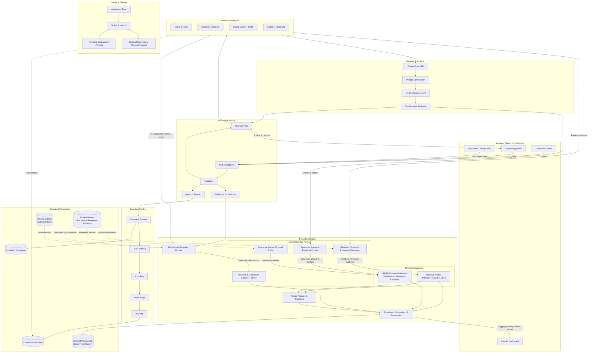

# RAG Evaluation Harness

A production-minded, full-stack evaluation and benchmarking platform for Retrieval-Augmented Generation (RAG) pipelines.

---

## 1. Project Overview

The **RAG Evaluation Harness** is a web-based benchmarking and analysis system designed to evaluate, compare, and diagnose RAG retrieval strategies and answer generation pipelines. Users can ingest documents, query them through multiple interchangeable retrieval configurations, evaluate system performance using both deterministic retrieval metrics and LLM-assisted evaluation frameworks, and visualize side-by-side comparative results in an interactive dashboard.

---

## 2. Problem Statement & Motivation

Most RAG applications are deployed as black-box prototypes without empirical measurement of their retrieval or generation quality. When an LLM produces an incorrect or ungrounded answer, teams struggle to determine the root cause:
- Did the retriever fail to surface relevant chunks (Retrieval Failure)?
- Did the retriever pull excessive irrelevant noise that confused the model (Context Distraction)?
- Did the LLM hallucinate despite having access to the correct context (Generation Failure)?

Tuning parameters like chunk size, overlap, embedding models, top-k, and reranking is often done through ad-hoc trial and error. The **RAG Evaluation Harness** solves this by establishing a disciplined, reproducible evaluation system that subjects different RAG configurations to the exact same evaluation questions and measures their empirical performance.

---

## 3. What I Built: Implemented vs. Planned Functionality

To maintain engineering transparency, the table below delineates current project status from upcoming phases:

| Capability Area | Status | Description |
|---|---|---|
| **Project Foundation & Architecture (Phase 0)** | **Implemented** | Repository directory structure, configuration templates (`.env.example`), `.gitignore`, Architectural Decision Records ([docs/decisions.md](docs/decisions.md)), and full system architecture specification ([docs/architecture.md](docs/architecture.md)). |
| **Backend Foundation — FastAPI (Phase 1)** | **Implemented** | Application entry point and factory (`create_app`), Pydantic Settings configuration (`backend/app/config.py`), operational health endpoint (`GET /health`), CORS middleware allowlist, and pytest test suite. |
| **Document Ingestion Pipeline** | *Planned (Phase 2)* | PDF/text extraction, cleaning, fixed and semantic chunking, embedding generation, Chroma indexing. |
| **Retrieval Strategies (A–D)** | *Planned (Phase 3)* | Basic vector search, semantic chunking retrieval, hybrid BM25 + vector search, and cross-encoder reranking. |
| **LLM Generation Pipeline** | *Planned (Phase 3)* | Prompt construction with context grounding, integration with NVIDIA-hosted Nemotron API. |
| **Evaluation Engine & Metrics** | *Planned (Phase 4)* | Deterministic retrieval metrics (Hit Rate, Recall@k, MRR), RAGAS answer quality metrics, and latency profiling. |
| **Frontend Web Application** | *Planned (Phase 5)* | React + TypeScript + Vite UI for document upload, query playground, experiment configuration, and metric dashboard. |
| **CI/CD & Deployment** | *Planned (Phase 6)* | GitHub Actions automated test suites, regression gates, and cloud deployment pipelines. |

> [!NOTE]
> *Current Phase Status:* Phase 0 and Phase 1 are implemented. The FastAPI web service foundation and test suite are operational. Document ingestion, RAG retrieval pipelines, and model APIs are planned for upcoming phases.

---

## 4. Core Features & Differentiation

Unlike standard RAG demo chatbots that merely wrap an LLM call around vector search, this harness is built around **comparative empirical evaluation**:

1. **Multi-Strategy Retrieval Benchmarking:** Run identical evaluation questions across four distinct retrieval architectures under uniform conditions.
2. **Decoupled Metric Analysis:** Separates retrieval evaluation (Hit Rate, Recall@k, MRR) from generation evaluation (RAGAS Faithfulness, Relevance) to pinpoint exact failure modes.
3. **Dual Dataset Design:** Employs a curated Golden Dataset for iterative parameter tuning alongside a separate Holdout Dataset to guard against hyperparameter overfitting.
4. **Visual Failure Diagnosis:** Diagnostic UI to inspect context chunks, identify retrieval misses, and analyze hallucination patterns.
5. **Configurable Pipeline Parameters:** Experiment with chunk sizes, similarity thresholds, top-k values, and reranking depth.

---

## 5. Planned Technology Stack

- **Frontend:** React 18, TypeScript, Vite, Tailwind CSS, Recharts, Axios
- **Backend:** Python 3.11+, FastAPI, Pydantic v2
- **RAG Orchestration:** LangChain / LCEL (where composable patterns add value)
- **Vector Storage:** Chroma (local embedded store with metadata persistence)
- **Embeddings:** Configurable embedding models (e.g., `sentence-transformers/all-MiniLM-L6-v2`)
- **Answer Generation:** NVIDIA-hosted Nemotron API (`nvidia/nemotron-4-340b-instruct`) via OpenAI-compatible REST endpoint
- **Evaluation:** RAGAS (Faithfulness, Answer Relevance, Context Precision) + Custom Retrieval Metrics (Hit Rate, Recall@k, MRR)
- **Testing:** Pytest (Backend) and Vitest / React Testing Library (Frontend)
- **Persistence:** Chroma for chunks/vectors; optional PostgreSQL for experiment metadata and run history
- **CI / Deployment Targets:** GitHub Actions CI; Vercel (Frontend SPA) and Render / Railway (Backend container)

---

## System Architecture

The end-to-end architecture is organized into modular subsystems covering ingestion, retrieval, generation, evaluation, storage, and quality delivery:



For detailed architectural component breakdowns and lifecycle flow documentation, see [docs/architecture.md](docs/architecture.md).

---

## 7. Results and Evaluation Benchmark Table

> [!IMPORTANT]
> All benchmarks in this table are pending implementation and empirical execution. No metrics, latencies, or scores are fabricated.

| Retrieval Strategy | Chunking Strategy | Reranker | Hit Rate@k | Recall@k | MRR | RAGAS Faithfulness | RAGAS Answer Relevance | Avg Latency (ms) | Status |
|---|---|---|---|---|---|---|---|---|---|
| **Strategy A: Basic Vector** | Fixed (512 tokens, 50 overlap) | None | *Pending measurement* | *Pending measurement* | *Pending measurement* | *Pending measurement* | *Pending measurement* | *Pending measurement* | Not yet implemented |
| **Strategy B: Semantic Chunking** | Semantic Boundary | None | *Pending measurement* | *Pending measurement* | *Pending measurement* | *Pending measurement* | *Pending measurement* | *Pending measurement* | Not yet implemented |
| **Strategy C: Hybrid Search** | Fixed (512 tokens, 50 overlap) | None (RRF) | *Pending measurement* | *Pending measurement* | *Pending measurement* | *Pending measurement* | *Pending measurement* | *Pending measurement* | Not yet implemented |
| **Strategy D: Hybrid + Reranking** | Fixed (512 tokens, 50 overlap) | Cross-Encoder | *Pending measurement* | *Pending measurement* | *Pending measurement* | *Pending measurement* | *Pending measurement* | *Pending measurement* | Not yet implemented |

---

## 8. Technical Decisions

All architectural trade-offs, technology choices, and provisional decisions are documented in formal Architectural Decision Records (ADRs):

- **[ADR-001](docs/decisions.md#adr-001-frontend-framework--react-with-typescript-and-vite):** Frontend Framework — React with TypeScript and Vite
- **[ADR-002](docs/decisions.md#adr-002-backend-framework--python-with-fastapi-and-pydantic):** Backend Framework — Python with FastAPI and Pydantic
- **[ADR-003](docs/decisions.md#adr-003-vector-store--chromadb):** Vector Store — ChromaDB
- **[ADR-004](docs/decisions.md#adr-004-answer-generation-llm--nvidia-hosted-nemotron-api):** Answer Generation LLM — NVIDIA-Hosted Nemotron API
- **[ADR-005](docs/decisions.md#adr-005-evaluation-framework--ragas-with-custom-retrieval-metrics):** Evaluation Framework — RAGAS with Custom Retrieval Metrics
- **[ADR-006](docs/decisions.md#adr-006-evaluation-dataset-strategy--golden-dataset-vs-separate-holdout-dataset):** Evaluation Dataset Strategy — Golden Dataset vs. Separate Holdout Dataset
- **[ADR-007](docs/decisions.md#adr-007-retrieval-configurations--multi-strategy-comparable-experiments):** Retrieval Configurations — Multi-Strategy Comparable Experiments
- **[ADR-008](docs/decisions.md#adr-008-experiment-history-persistence--optional-postgresql):** Experiment History Persistence — Optional PostgreSQL
- **[ADR-009](docs/decisions.md#adr-009-deployment-targets--vercel-frontend-and-renderrailway-backend):** Deployment Targets — Vercel (Frontend) and Render/Railway (Backend)
- **[ADR-010](docs/decisions.md#adr-010-backend-structure-pydantic-settings-and-health-endpoint-scope):** Backend Structure, Pydantic Settings, and Health Endpoint Scope

Full ADR descriptions, rationale, and alternatives considered are maintained in [docs/decisions.md](docs/decisions.md).

---

## 9. Testing and CI Strategy

- **Unit Testing (Backend):** Pytest test suites covering configuration validation, CORS allowlist logic, and route status codes (implemented in Phase 1). Subsequent phases will add document parsing, chunking boundary logic, and metric calculations (Hit Rate, Recall@k, MRR).
- **Unit & Component Testing (Frontend):** Vitest and React Testing Library verifying parameter inputs, chart renders, and API mock handling (planned for Phase 5).
- **Integration Testing:** End-to-end evaluation flow validation with mock embeddings and mock LLM responses to ensure test determinism.
- **Continuous Integration (GitHub Actions):** Automated linting (Ruff / ESLint), type checking (Mypy / TypeScript), test execution, and evaluation regression threshold gates.

---

## 10. Setup and Usage

### Prerequisites
- Python 3.11+ (Windows `py` launcher or `python`)
- Node.js 18+ and npm (for upcoming frontend phase)

### 1. Environment Setup

Copy the environment template to create your local `.env` file:

```powershell
Copy-Item .env.example .env
```

### 2. Backend Virtual Environment & Installation

From the repository root, create and activate a Python virtual environment:

```powershell
py -m venv .venv
.\.venv\Scripts\Activate.ps1
```

Install the minimal Phase 1 dependencies:

```powershell
pip install -r backend/requirements.txt
```

### 3. Run Backend Tests

Execute the pytest suite using the active virtual environment:

```powershell
pytest
```

### 4. Start the Development Server

Launch the FastAPI application with auto-reload:

```powershell
uvicorn backend.app.main:app --reload --host 0.0.0.0 --port 8000
```

### 5. Verify the API

- **Health Check Endpoint:** `http://localhost:8000/health`
  Expected response:
  ```json
  {
    "status": "ok",
    "environment": "development",
    "version": "0.1.0"
  }
  ```
- **Interactive OpenAPI Documentation (Swagger UI):** `http://localhost:8000/docs`
- **ReDoc Documentation:** `http://localhost:8000/redoc`

---

## 11. Limitations and Future Work

- **Local Embedding Latency:** Initial implementation will default to CPU-friendly sentence transformers; GPU acceleration or optimized ONNX runtimes are planned for high-throughput batch evaluation.
- **Multi-Hop Reasoning:** Current evaluation metrics focus on single-hop retrieval; complex multi-hop multi-document synthesis will be addressed in future iterations.
- **Relational History:** PostgreSQL persistence is optional for early phases; file-based run storage will precede database migration.
- **Dynamic Context Expansion:** Future work includes parent-child document retrieval and recursive context expansion.