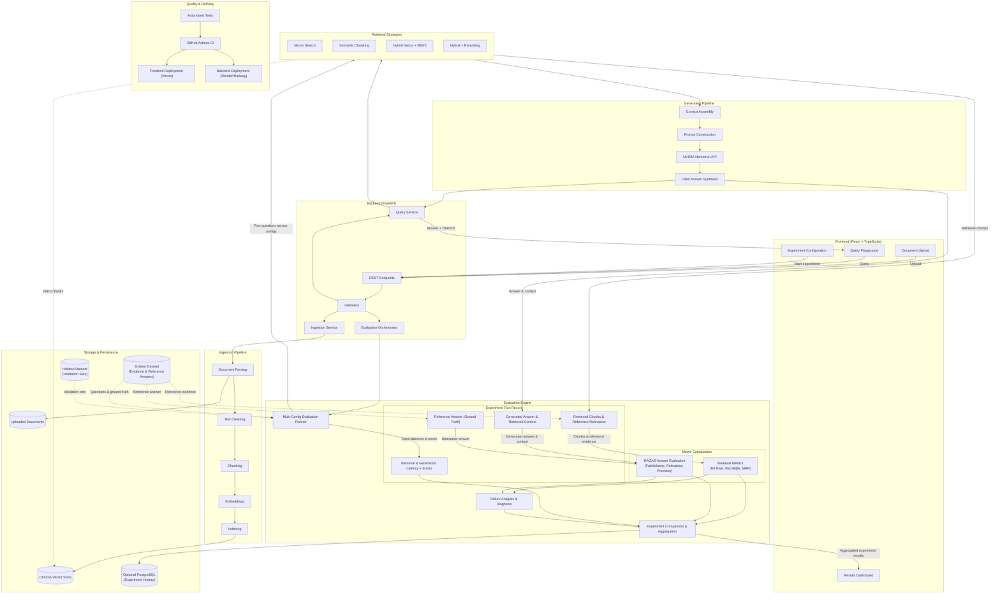

# System Architecture — RAG Evaluation Harness

This document describes the architectural design, component boundaries, data flow, and evaluation lifecycle of the **RAG Evaluation Harness**.

---

## 1. System Architecture Diagram

---

## 2. Major Component Boundaries

### 2.1 Frontend (React + TypeScript + Vite)
- **Role:** Presents an interface for document ingestion, exploratory ad-hoc queries, experiment execution configuration, and evaluation analysis.
- **Key Modules:**
  - `Document Upload`: Multi-file upload with progress tracking and metadata assignment.
  - `Query Playground`: Interactive single-query testing allowing runtime selection of retrieval strategy, top-k, and temperature.
  - `Experiment Configuration`: Form to launch batch evaluations across defined strategies over selected test datasets.
  - `Results Dashboard`: Visualizes comparative metrics and item-level failure inspections.
- **Boundaries:** Completely decoupled from RAG and LLM logic; communicates strictly via asynchronous JSON REST APIs.

### 2.2 Backend (Python + FastAPI + Pydantic)
- **Role:** Central application server coordinating validation, document processing, RAG orchestration, and evaluation runs.
- **Key Modules:**
  - `API Routes & Middleware`: CORS, error handling, rate limiting, and endpoint routing.
  - `Pydantic Models`: Request validation schemas, configuration data classes, and serialized metric responses.
  - `Ingestion Service`: Coordinates document parsing, chunking, embedding generation, and vector indexing.
  - `Query Service`: Executes single-turn RAG queries across configurable retrieval strategies.
  - `Evaluation & Experiment Orchestrator`: Manages batch benchmark execution, metrics calculation, and results aggregation.

### 2.3 Document Ingestion Pipeline
- **Role:** Transforms unstructured documents into searchable vector and lexical representations.
- **Steps:**
  1. *Parsing:* Extracts text and structural metadata from PDF, TXT, or Markdown documents.
  2. *Cleaning:* Normalizes whitespace, strips extraction artifacts, and preserves headings.
  3. *Chunking:* Implements configurable chunking strategies (fixed-window with overlap vs. semantic boundary chunking).
  4. *Embedding Generation:* Computes dense embeddings using configurable models (e.g., local Sentence-Transformers).
  5. *Indexing:* Writes chunk embeddings and metadata to ChromaDB and constructs lexical indices for BM25.

### 2.4 Storage & Persistence
- **Chroma Vector Store:** Embedded vector database storing chunk embeddings, chunk text, document identifiers, and chunk index metadata.
- **Uploaded Documents:** Local directory (`data/uploads/`) holding raw source files.
- **Golden Evaluation Dataset (`data/golden/`):** Fixed set of curated evaluation queries, reference contexts, and ground-truth answers for development iteration.
- **Holdout Test Dataset (`data/holdout/`):** Separate validation set reserved for unbiased evaluation and regression checks.
- **Optional PostgreSQL:** Relational store reserved for enterprise experiment persistence, multi-user runs, and historical audit logs.

### 2.5 Configurable RAG Retrieval
Supports four distinct strategies tested under identical conditions:
- **Strategy A (Basic Vector Search):** Standard cosine-similarity dense retrieval over fixed chunks.
- **Strategy B (Semantic Chunking + Retrieval):** Dense retrieval over chunks determined by semantic breakpoint distances.
- **Strategy C (Hybrid Vector + BM25 Search):** Reciprocal Rank Fusion (RRF) combining dense semantic vectors and sparse lexical BM25 scores.
- **Strategy D (Hybrid Retrieval + Reranking):** Two-stage retrieval retrieving candidate chunks via hybrid search followed by a cross-encoder reranker.
- **Context Assembly:** De-duplicates chunks, formats context blocks with source provenance, and bounds context by token budget.

### 2.6 Answer Generation
- **Prompt Construction:** Strict grounding prompt instructing the model to answer exclusively from retrieved context and cite source chunks.
- **NVIDIA-hosted Nemotron API:** External model endpoint queried via an OpenAI-compatible REST client.
- **Answer Synthesis:** Produces grounded answers with explicit chunk citations, tracking latency and token usage.

### 2.7 Evaluation Engine
- **Orchestration:** Executes the exact same query set across all active retrieval configurations.
- **Retrieval Metrics (Deterministic):**
  - *Hit Rate@k:* Proportion of queries where at least one ground-truth context is retrieved in top-k.
  - *Recall@k:* Proportion of all relevant ground-truth contexts retrieved in top-k.
  - *Mean Reciprocal Rank (MRR):* Rank position of the first relevant chunk.
- **Answer-Quality Metrics (RAGAS + LLM Judge):**
  - *Faithfulness:* Groundedness of the generated answer against retrieved context.
  - *Answer Relevance:* Semantic relevance of the answer to the user's question.
  - *Context Precision:* Signal-to-noise ratio of retrieved chunks.
- **Failure Analysis:** Categorizes failures into *Retrieval Failure* (relevant context missed), *Context Overflow* (irrelevant context distracting model), or *Generation Hallucination* (context present but answer incorrect).

### 2.8 Quality & Delivery
- **Testing:** Unit tests for chunking and metrics via Pytest; component tests for frontend.
- **GitHub Actions:** Runs linting, tests, and automated evaluation regression thresholds on pull requests.
- **Deployment Targets:** Vercel for frontend SPA hosting; Render/Railway for backend containerized hosting with attached storage volume.

---

## 3. End-to-End Data & Execution Flows

### 3.1 Document Ingestion Flow
1. User uploads a document via the UI.
2. Ingestion service writes the raw file to `data/uploads/`.
3. Ingestion pipeline extracts text, cleans formatting, applies selected chunking strategy, generates embeddings, and persists chunks and vectors to ChromaDB.
4. Ingestion summary (chunk count, token statistics) returns to the UI.

### 3.2 Evaluation & Experiment Flow
1. User selects benchmark dataset (Golden or Holdout) and chooses retrieval configurations to compare (e.g., Strategy A vs. Strategy C vs. Strategy D).
2. Evaluation Orchestrator loads questions and ground-truth contexts.
3. For each configuration:
   - Queries are dispatched through the retrieval pipeline.
   - Deterministic retrieval metrics (Hit Rate, Recall@k, MRR) are calculated against ground-truth contexts.
   - Retrieved contexts and questions are passed to Nemotron for answer generation.
   - Generated answers are evaluated via RAGAS metrics for faithfulness and relevance.
   - Latency per stage is captured.
4. Experiment Aggregator compiles comparative tables and failure logs.
5. Frontend dashboard renders side-by-side performance charts and highlights failure cases.
